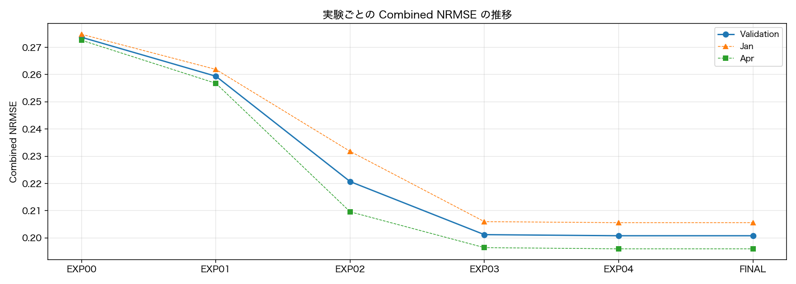

# HuMob Challenge 2026 — 能登半島地震後の人流 OD 行列予測

2024年能登半島地震後の復興期について、欠損している2024年2月・3月の日次 OD 行列
（出発セル→到着セルの移動人数）を予測するモデルの実装です。最終的に採用したモデル
（状態空間モデル＋リッジ回帰による、出発側・到着側の2方向分解の平均）を `src/` に置いています。

## 結果
5位/80チーム　入賞

## 概要

HuMob Challenge 2026 は、New York University と LY Corporation が主催する人流予測コンペティションです。
データは約2 km のグリッド間を移動した人数を、日付ごとの疎な OD 辞書として表したものです。
学習には震災前から2024年1月末までと、2024年4月以降の観測を使えます。
ニュース・行政資料・気象などの公開情報も利用できますが、別の人流データセットは使えません。

| 項目 | 内容 |
|---|---|
| 予測対象 | 能登・石川の対象地域における日次 OD 行列 |
| 学習期間 | 2023-11-01〜2024-01-31、2024-04-01〜2024-10-31 |
| テスト期間 | 2024-02-01〜2024-03-31 のうち、欠測2日を除く58日 |
| 評価範囲 | `x=30〜70`、`y=35〜70` の1,476グリッドセル |
| 評価指標 | **Combined NRMSE**（小さいほど良い） |

Combined NRMSE は、同じセル内の移動量（対角）とセル間の移動量（非対角）をそれぞれ正規化して評価し、
2つの NRMSE を単純平均した指標です。

## モデル

| 成分 | 方法 |
|---|---|
| 対角（セル内の滞留） | セルごとのローカルレベル＋曜日・年末年始＋外部特徴（避難者率・断水率・降水量） |
| 非対角・出発側 | 出発セルの総流出量 × 到着先への配分比 |
| 非対角・到着側 | 到着セルの総流入量 × 出発元からの配分比 |
| 非対角の最終値 | 出発側と到着側の 1:1 平均 |

- 各成分は、状態空間モデル（カルマンフィルター＋RTSスムーザー）とリッジ回帰を EM で交互に推定します。
- 非対角の外部特徴は、避難者率・断水率・降水量・積雪・避難所です。
- 詳しくは [`src/README.md`](src/README.md) を参照してください。

## セットアップ

```bash
git clone <このリポジトリ>
cd Humob
python3 -m venv .venv
source .venv/bin/activate
python3 -m pip install -r requirements.txt
```

## データの準備

コンペ配布データと前処理済みデータは再配布しないため、このリポジトリには含まれていません。
各自で用意し、次の位置に置いてください。

```text
data/
├── raw/
│   └── humob2026-dataset.tsv               コンペ配布データ（日付\t{origin: {destination: value}}）
└── processed/
    ├── events/population_cell_map.csv      セルの担当市町・緯度経度
    ├── 避難者率/市町別避難者率.csv           市町別の避難者率（公表日ごと）
    ├── 断水率/市町別断水率.csv               市町別の断水世帯率（公表日ごと）
    ├── 避難所/避難所_セル別集計.csv          セルごとの避難所施設数
    └── weather/weather.csv                 気象庁観測所ごとの日降水量・最深積雪
```

- 前処理済みCSVは、石川県の被害情報・人口・世帯数・避難所一覧・気象庁データなどの公開資料から作ったものです。作成コードは公開していません。
- 公式validatorを使う場合は `src/evaluation/humob2026_validator.py` に置いてください（git 管理外）。

## 使い方

リポジトリのルートで実行します。モードは必ず1つ指定してください。

```bash
python3 src/main.py --validate        # ローカル検証（CV14日を学習から外して学習・採点）
python3 src/main.py --submit          # 全観測日で学習し、テスト58日の提出ファイルを生成
python3 src/main.py --inspect         # 設定と学習データの概要を表示するだけ（ファイルを書かない）
python3 src/main.py --check [PATH]    # 既存の提出ファイルを公式validatorで検査
```

ローカル検証には、テスト期間を前後から挟む14日を使います（2024-01-25〜01-31、2024-04-01〜04-07）。

## 出力

すべて `experiments_final/` に書き出します。

| ファイル | 作るモード | 内容 |
|---|---|---|
| `outputs/submission.tsv` | `--submit` | 提出ファイル（58日分。git 管理外） |
| `metrics.json` | `--validate` | 検証スコア（14日・1月・4月）、5成分の収束診断、設定 |
| `outputs/validation_{jan,apr}.tsv` | `--validate` | CV期間の予測（git 管理外） |
| `.log` | `--validate`・`--submit` | 実行ごとの stage・所要時間・結果（追記のみ。git 管理外） |

## ディレクトリ構成

```text
.
├── README.md
├── EDA.md                       探索的データ分析のまとめ
├── requirements.txt
├── src/                         最終モデルの実装（詳細は src/README.md）
│   ├── main.py                  エントリポイント
│   ├── config.py                入出力パスとハイパーパラメータ
│   ├── dataset/                 配布OD・前処理済みCSV → モデル入力の配列
│   ├── models/                  カルマン平滑化・リッジ回帰・EM推定・OD予測本体
│   ├── evaluation/              公式指標・提出形式の検査
│   └── utils/                   OD TSV の入出力・実行ログ
├── experiments_final/           最終モデルの実行記録
│   ├── report.md                最終モデルで何をして何が分かったか（考察・再現確認）
│   ├── metrics.json             検証スコアの数値
│   ├── .log                     実行ログ（git 管理外）
│   └── figures/                 スコア推移・セル別誤差・日次推移の図
└── figures/                     EDA の図
```

## 実験一覧

ローカル検証14日の Combined NRMSE です。EXP00〜EXP03 の実験記録は公開していません。
実験コードは commit `129ea2e` の `src/` にあります。

| ID | 日付 | 概要 | 比較元 | 統合 | jan | Δjan | apr | Δapr | 判定 |
|---|---|---|---|---:|---:|---:|---:|---:|---|
| EXP00 | 2026-09-21 | 学習データ端点（1/22・4/9）の線形補間 | - | **0.2737** | 0.2748 | - | 0.2726 | - | 基準 |
| EXP01 | 2026-09-21 | 同曜日の前後2点による曜日別線形補間 | EXP00 | **0.2594** | 0.2619 | -0.0129 | 0.2568 | -0.0158 | 採用 |
| EXP02 | 2026-09-21 | A窓2種×出現時代表値2種を比較（震災前を含むA窓×平均値を採用） | EXP01 | **0.2207** | 0.2318 | -0.0301 | 0.2096 | -0.0472 | 採用 |
| EXP03 | 2026-09-21 | 対角セル別状態空間＋非対角総量×配分（避難・断水・気象を採用） | EXP02 | **0.2012** | 0.2060 | -0.0258 | 0.1964 | -0.0132 | 採用候補 |
| [FINAL](experiments_final/report.md) | 2026-09-21 | EXP03の非対角を出発側・到着側から推定し1:1結合 | EXP03 | **0.2008** | 0.2056 | -0.0004 | 0.1960 | -0.0004 | 採用 |

### スコア推移



## 公開範囲

このリポジトリで公開するのは、最終モデルの実装・その実行記録・EDA のまとめです。
コンペ配布データ、外部資料の原本、前処理済みデータ、前処理と可視化のコードは含みません。
