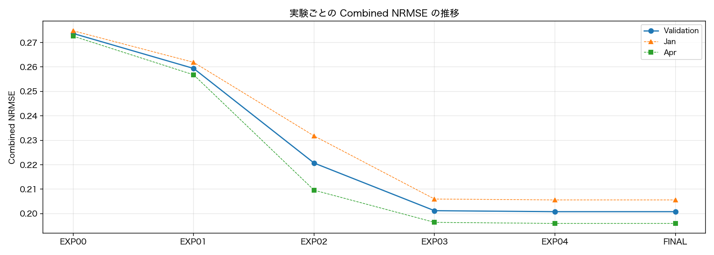
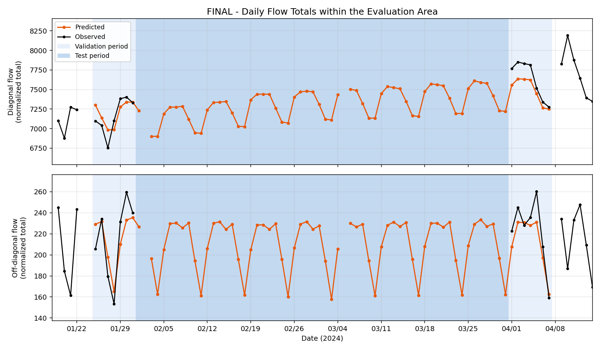
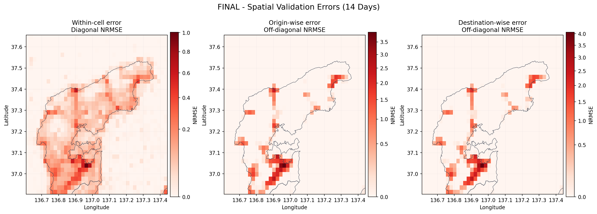

# レポート

## 要約

- **何をしたか：** 能登半島地震後の欠損期間（2024年2〜3月）の日次ODを予測するため、時間とともに動く水準を状態空間モデルで平滑化し、そこに曜日・外部特徴の回帰を重ねた。非対角は「総量×配分」に分け、出発側・到着側の2通りの推定を1:1で平均した。
- **精度：** ローカル検証14日の Combined NRMSE は **0.2008**。全ゼロ予測（0.9602）の約5分の1で、出発点の線形補間（EXP00、0.2737）から26.6%改善した。
- **最も効いたもの：** 前後の観測から水準を平滑化する状態空間モデルと、避難者率。降水量・断水率は組み合わせたときにだけ効き、積雪や残差補正（CatBoost）は精度を下げた。
- **残っている誤差：** 誤差の約8割は非対角（セル間移動）にある。非対角の誤差は、既存ODの量の推定（71%）と、記録されない日に小さな正の値を出してしまうこと（27%）から来ている。
- **モデルの性質：** 予測の大部分は「1月末と4月初めの水準を滑らかにつなぐ傾向＋毎週同じ曜日周期」でできている。外部特徴の影響は数%程度の微調整で、日ごとの急な変動は捉えられない。

## 何をしたか

### 最終モデルの構成

| 成分 | 予測する量 | 外部特徴 |
|---|---|---|
| 対角（D5） | セル内滞留の `log1p` | 避難者率・断水率・降水量（セル別の偏差も持つ） |
| 出発側（F） | 出発セルの総流出量の `log1p` × 到着先への配分比 | 避難者率・断水率・降水量・積雪・避難所 |
| 到着側（R） | 到着セルの総流入量の `log1p` × 出発元からの配分比 | 同上（出発・到着の役割を入れ替え） |
| 非対角の最終値 | 0.5 × F + 0.5 × R | — |

各成分は、ランダムウォークの潜在水準（カルマンフィルター＋RTSスムーザー）と、曜日・年末年始・外部特徴のリッジ回帰を、EMで交互に推定する。状態は地震の発生日（2024-01-01）でリセットする。数式と実装の詳細は [`src/README.md`](../src/README.md) にある。

### この構成に至った経緯

| ID | 内容 | Combined | 対角 | 非対角 |
|---|---|---:|---:|---:|
| EXP00 | 欠損区間の両端2日の線形補間 | 0.2737 | 0.1171 | 0.4303 |
| EXP01 | 同じ曜日の前後2点で補間 | 0.2594 | 0.1077 | 0.4110 |
| EXP02 | ODの出現確率と代表値の組み合わせ | 0.2207 | 0.1087 | 0.3327 |
| EXP03 | 状態空間モデル＋総量×配分＋外部特徴 | 0.2012 | 0.0855 | 0.3170 |
| **EXP04（本モデル）** | EXP03 の非対角を出発側・到着側から推定して平均 | **0.2008** | **0.0855** | **0.3162** |

### この記録で行ったこと

1. EXP04 の実験コードから最終モデルだけを取り出し、[`src/`](../src/README.md) として組み直した。
2. 組み直したコードが EXP04 と同じ予測を出すことを確かめた（「再現確認」節）。
3. CV予測を正解と突き合わせ、誤差がどこに・どのように出ているかを集計した。
4. CV学習時の回帰係数を取り出し、モデルが何を学んだかを調べた。

3と4の集計は、[`metrics.json`](metrics.json) と `outputs/validation_{jan,apr}.tsv` を使って行った一度限りの分析で、`src/` には含めていない。

## 検証の設計

- **CV：** テスト期間を前後から挟む 2024-01-25〜01-31 と 2024-04-01〜04-07 の14日。両方の窓を同時に学習から外し、1組のモデルで予測する。
- **学習：** CVを除く278観測日。候補ODは、学習期間に一度でも正の値をとった有向の非対角ペア525本。
- **採点：** 公式 Combined NRMSE。日ごとに対角・非対角のRMSEを出し、期間平均を固定の定数で正規化して平均する。
- **注意：** この14日は EXP00〜EXP04 のモデル選択にも使ったので、独立したテストスコアではない。

## 結果

| 窓 | 日数 | NRMSE_diag | NRMSE_off | **Combined NRMSE** |
|---|---:|---:|---:|---:|
| **統合** | 14 | 0.085460 | 0.316168 | **0.200814** |
| `jan` | 7 | 0.090423 | 0.320819 | 0.205621 |
| `apr` | 7 | 0.080496 | 0.311517 | 0.196006 |
| 参考：全ゼロ予測 | 14 | 0.944261 | 0.976107 | 0.960184 |

全ゼロ予測と比べると、対角の誤差は91%、非対角は68%減った。Combined NRMSE は対角と非対角の単純平均なので、0.2008 のうち 0.1581（**79%**）が非対角の寄与である。

## 何が分かったか

### 1. 精度を上げたのは「水準の平滑化」と「避難者率」

EXP03 のアブレーション（同じCV14日での比較）から、各要素の効果を切り分けられる。

| 比較 | 対角 NRMSE | 非対角 NRMSE |
|---|---:|---:|
| 固定効果モデル（水準を地震前後の2段階に固定） | 0.1198 | 0.3278 |
| 状態空間モデル・外部特徴なし | 0.1031（−14%） | 0.3219（−2%） |
| ＋避難者率だけ | 0.0909（−12%） | 0.3175（−1.4%） |
| ＋断水率だけ | 0.1027（−0.4%） | 0.3225（+0.2%） |
| ＋降水量だけ | 0.1026（−0.5%） | 0.3220（±0%） |
| ＋積雪だけ | 0.1043（+1.2%） | 0.3221（+0.04%） |
| **採用：対角は避難者率・断水率・降水量** | **0.0855（−17%）** | — |
| ＋積雪も加える | 0.0865（+1.2%） | — |
| **採用：非対角は5群すべて** | — | **0.3170（−1.5%）** |

括弧内は、1行目は固定効果モデルとの差、2行目以降は「状態空間モデル・外部特徴なし」との差、「積雪も加える」は採用構成との差。

- **水準を時間とともに動かすことが最も効いた。** 地震前後で水準を固定するのではなく、前後の観測から日ごとの水準を平滑化すると、対角の誤差が14%減った。
- **外部特徴では避難者率が中心。** 断水率・降水量は単独ではほぼ効かないが、避難者率と組み合わせると対角の誤差をさらに6%下げた。
- **積雪は精度を下げた。** 単独でも組み合わせても悪化したため、対角から外した。
- **非対角への外部特徴の効果は小さい。** 5群すべてを入れても1.5%の改善にとどまる。セル間移動の変化は、外部特徴より潜在水準と曜日周期が担っている。

### 2. 予測の大部分は「両端をつなぐ傾向＋曜日周期」

テスト期間（2〜3月）の予測を見ると、モデルの振る舞いがよく分かる。

- **対角：** 1月末の水準（約7,200）から4月初めの水準（約7,600）へ、ほぼ直線的に上がる。RTSスムーザーが、欠損区間の前後の観測をつないで潜在水準を補間しているためである。
- **非対角：** 平日約230、日曜約160という、毎週同じ形の周期が2か月続く。

学習診断でも、潜在水準がゆっくりしか動かないことが分かる。対角の状態ノイズ $Q=0.00038$ は、1日あたり約2%の水準変化に相当する。観測ノイズ $R=0.105$（1日あたり約32%のばらつき）よりはるかに小さい。日々の変動の大部分は「ノイズ」として扱われ、潜在水準は滑らかに保たれる。

**回帰係数から読めること**（CV学習時。外部特徴は標準化済みなので、係数は「その特徴が1標準偏差増えたとき」の効果）

| 成分 | 避難者率 | 断水率 | 降水量 | 積雪 | 避難所×避難者率 |
|---|---:|---:|---:|---:|---:|
| 対角（`log1p`） | −1.4% | −1.3% | −0.6% | — | — |
| 出発側総量（`log1p`） | +2.8% | ±0% | −0.3% | −0.1% | +0.6% |
| 到着側総量（`log1p`） | +2.2% | +0.2% | −0.3% | −0.1% | +0.9% |

| 成分 | 火〜金（月曜比） | 土曜 | 日曜 | 年末年始 |
|---|---:|---:|---:|---:|
| 出発側総量 | +3〜4% | −3% | −9% | +4% |
| 到着側総量 | +3〜4% | −3% | −8% | +4% |
| 対角 | ±0.5%以内 | +0.1% | −0.1% | +8% |

- **避難者率が高い地域では、セル内の滞留がやや減り、セル間の移動がやや増える方向**に係数が推定された。避難所への移動や生活拠点の分散と矛盾しない向きだが、大きさは1標準偏差あたり数%にとどまる。
- **セル間移動には明確な週の周期がある**（平日に多く、日曜に約9%少ない）。セル内滞留の曜日差は、セル平均ではほとんどない。
- **年末年始は、セル内滞留が8%、セル間移動が4%多い。**
- 配分（どこへ行くか）の係数は、比率の尺度で最大0.011と小さい。行き先の構成は、外部特徴よりも各ODの潜在水準で決まっている。

ただし、これらは予測のために推定した関係で、因果効果ではない。避難者率は被害の大きさや復旧の進み具合とも連動しており、潜在水準とも一部で役割が重なる。

### 3. 非対角の誤差は「量の推定」と「出すべきでない日の小さな予測」

14日間の非対角の二乗誤差を、正解と予測の辞書に現れたかで分けた。

| 分類 | 意味 | 二乗誤差に占める割合 |
|---|---|---:|
| hit | 正解・予測の両方にあるODの量の誤差 | 71.0% |
| extra | 予測にはあるが、その日の正解には記録がないOD | 26.9% |
| miss | 正解にはあるが、予測していないOD | 2.1% |

- **候補ODを学習期間の525本に絞った損失はほぼない。** CV14日に正解に現れたOD 1,658件のうち99.6%（量では99.8%）が候補に含まれていた。
- **予測は正解より3.7倍多くのODに値を出している。** 正解に記録があるのは1日あたり約120件だが、予測は約440件に正の値を出す。正解は記録のない日が多い疎なデータなのに対し、モデルは毎日、平均的な小さな値を出すため、extra の誤差が27%を占める。ODが「その日に記録されるか」をモデル化すれば、改善の余地がある。

### 4. 誤差は七尾市中心部に集中し、相対的に難しいのは能登町・羽咋市

- **集中度：** 非対角の二乗誤差の13%が上位10本のOD、39%が上位50本（528本中）に集まる。上位は七尾市中心部の隣接セル間の移動（`41_46↔41_47↔41_48` など）だった。対角も、上位100セル（1,476セル中）で二乗誤差の80%を占める。
- **地域別の難しさ：** 誤差の量では七尾市が最大（対角の41%、非対角の50%）だが、これは流量が多いからである。全ゼロ予測を1とした相対誤差で比べると、評価が変わる（出発セルの市町で集計）。

| 市町 | 対角 | 非対角 | 非対角：予測 / 正解の合計 |
|---|---:|---:|---:|
| 七尾市 | 0.006 | 0.07 | 1,676 / 1,759 |
| 輪島市 | 0.007 | 0.09 | 298 / 279 |
| 珠洲市 | 0.026 | 0.20 | 265 / 268 |
| 中能登町 | 0.009 | 0.22 | 452 / 467 |
| 志賀町 | 0.016 | 0.24 | 170 / 183 |
| 穴水町 | 0.018 | 0.28 | 86 / 58 |
| 羽咋市 | 0.023 | 0.55 | 25 / 36 |
| 能登町 | 0.016 | **0.98** | 18 / 12 |

対角はどの市町でも全ゼロ予測の3%以下まで誤差を減らせている。非対角では、**流量の少ない能登町は全ゼロ予測とほぼ同じ誤差**で、セル間移動をほとんど予測できていない。穴水町と能登町は予測が正解より多く、羽咋市は少ない。羽咋市は評価領域に一部しか含まれない。

### 5. 4月初めは系統的に過小予測、1月末は曜日パターンがずれる

| 窓 | 対角の日次合計（予測 − 正解） | 非対角の日次合計（予測 − 正解） |
|---|---|---|
| 1月末 | −1.6%〜+3.4%（日によって正負が入れ替わる） | 木・土・日に +8〜+11%、月・火に −9〜−10% |
| 4月初め | **7日すべてで過小**（−0.3%〜−2.7%） | 7日中5日で過小（平均 −4.1%） |

- **4月初めは、回復の速さに水準が追いついていない。** 実測は4月に入って一段高くなるが、予測は2〜3月から滑らかにつないだ水準のため、やや低く出る。
- **1月末は、曜日パターンが学習期間の平均と違った。** 予測の曜日周期は通年でひとつの係数なので、地震直後の特殊な週の形を表せない。
- **日ごとの急な変動は捉えられない。** 非対角 NRMSE は日によって 0.281（1/28）〜0.352（1/26）と大きく揺れ、1/30・4/5 の跳ね上がりも予測に現れていない（日次推移図）。

### 6. 出発側と到着側の平均は、わずかに効いた

| 非対角の推定 | 非対角 NRMSE | Combined NRMSE |
|---|---:|---:|
| 出発側だけ（EXP03 と同じ） | 0.316977 | 0.201218 |
| 到着側だけ | 0.316599 | 0.201029 |
| **1:1で平均（本モデル）** | **0.316168** | **0.200814** |

- 平均すると、1月・4月のどちらの窓でも出発側だけより良くなった。ただし改善は0.2%と小さい。
- 両側の誤差の相関は0.992で、ほぼ同じ予測である。同じ観測を異なる分母で分解しているだけなので、新しい情報が加わるわけではない。平均の効果は、よく似た2つの予測のばらつきを少し打ち消す程度である。

## 再現確認

組み直した `src/` が EXP04 と同じ予測を出すことを、同じ環境（macOS 26.4.1・Apple M5・Python 3.9.6）で確かめた（2026-10-18）。比べたのは次の3つである。

- 今回 `src/main.py` で実行した出力
- 旧コード（commit `129ea2e` の `src/EXP04_run.py`）を今回再実行した出力
- 2026-09-21 に保存された EXP04 の成果物

| 項目 | 結果 |
|---|---|
| 前処理8ファイル（非公開の前処理コードで再生成） | 既存の `data/processed/` とバイト単位で一致 |
| スコア（14日・1月・4月、小数6桁） | 3つとも一致。丸める前の倍精度でも差は最大 1.7e-16 |
| 5成分の学習診断（反復数・q・r・目的関数など） | 3つとも一致 |
| 非対角・評価外の予測値（提出物 586,918個、CV予測 139,939個） | 3つともビット単位で一致 |
| 対角の予測値 | 新srcだけ最下位桁が異なる（提出物で相対差最大 1.7e-11） |
| 公式validator | 新srcの提出物は合格 |

対角の差について、次のことを確かめた。

- 対角モデルへの入力は、新旧でビット単位で一致する。
- 新旧の関数を同じプロセスで同じ配列に適用すると、回帰・平滑化・200回のEM推定までビット単位で一致する。
- 差は別プロセスで実行したときだけ出る。新旧どちらも、同じ実行条件なら毎回同じ値を出す。

つまり計算内容は同一である。ただし、最下位桁を変えているプロセスの状態は特定できていない（特徴配列のメモリ上の位置・メモリの確保状況・matplotlib の読み込みは原因ではなかった）。

## 失敗した試み

| 試み | 結果 | 理由の考察 |
|---|---|---|
| CatBoost による残差補正（EXP03） | 対角 NRMSE が 0.0855 → 0.198 と大幅に悪化、非対角も微悪化 | 欠損区間の内部では残差の手がかりが乏しく、学習期間の残差の形が2〜3月に当てはまらなかったと考えられる |
| 積雪を特徴に加える | 対角が単独で+1.2%、組み合わせでも+1.2%悪化 | 積雪は季節と強く連動し、潜在水準と役割が重なる |
| 到着側だけに置き換える（EXP04） | 全体ではわずかに改善したが、1月窓で悪化 | 単独より両側の平均のほうが安定した |
| 水準を地震前後で固定する（EXP03） | 採用構成と比べて対角で40%、非対角で3%悪い | 復興期の水準は日々変化しており、2段階では表せない |

